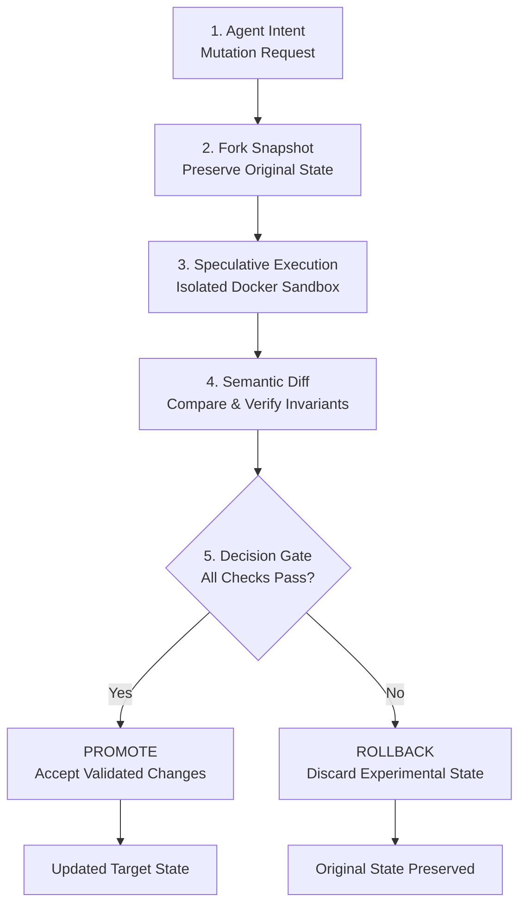
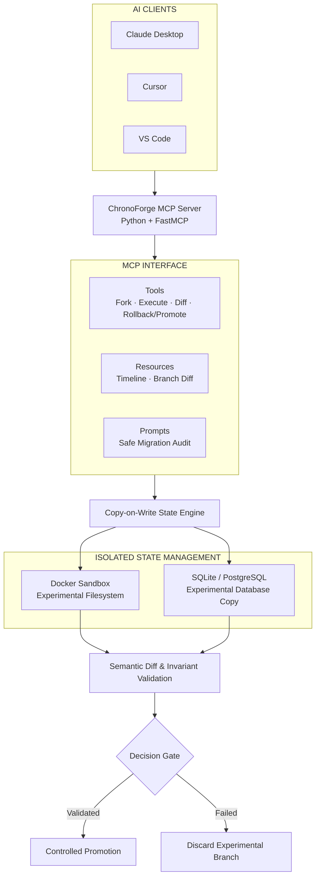

# ⏳ ChronoForge MCP
### Speculative Execution & Time-Travel State Server for Autonomous AI Agents

**Track 01 — Make MCP Matter | wHACKiest 2026**

> Turning autonomous AI agents from risky executors into safe, reversible engineers.

---

## 🚨 The Problem

Autonomous AI agents are becoming increasingly capable of interacting with real-world development environments. They can execute shell commands, modify files, run database migrations, update configurations, and manage application infrastructure.

But there is a fundamental problem:

**What happens when an autonomous agent makes a destructive mistake?**

A single incorrect operation can:
- Delete critical database tables or records.
- Corrupt application files and configurations.
- Break running services.
- Execute irreversible shell commands.
- Introduce changes that are difficult to recover from.

Traditional development tools offer partial protection through Git version control, database transactions, and backups. However, these mechanisms do not provide one unified, agent-facing workflow for experimenting with changes across supported filesystems and database state before accepting them.

Autonomous agents need more than the ability to execute commands. They need a safe environment in which to experiment, inspect consequences, and recover from failures.

## 💡 Our Solution — ChronoForge MCP

ChronoForge is an MCP-native speculative execution and state-management server that enables autonomous AI agents to experiment with potentially destructive operations inside isolated environments before those changes reach the original state.

It introduces a Git-inspired branching and time-travel approach to software execution.

Instead of allowing an agent to directly modify a live environment, ChronoForge:

1. Creates a checkpoint of the original state.
2. Forks an isolated experimental environment.
3. Executes the requested operation inside the sandbox.
4. Computes a semantic difference between the original and experimental states.
5. Runs invariant and health checks.
6. Promotes validated changes or discards failed experiments.

**Core principle: Experiment first. Validate second. Commit only when safe.**

---

## ⚙️ How ChronoForge Works

ChronoForge follows a five-stage execution pipeline.



### Stage 1 — Agent Intent

An MCP-compatible AI client submits a request to perform a potentially destructive operation.

Examples include:
- SQL schema migrations.
- File modifications and deletions.
- Configuration updates.
- Application-level operations.

### Stage 2 — Fork Snapshot

ChronoForge preserves the original state and creates an independent experimental branch.

The proposed architecture uses Docker's Copy-on-Write filesystem capabilities and database snapshot or copy mechanisms.

### Stage 3 — Speculative Execution

The requested operation executes inside an isolated Docker environment.

The original environment remains separate from the experimental branch.

### Stage 4 — Semantic Diff & Invariant Verification

ChronoForge compares the original and experimental states.

It identifies:
- Added, modified and deleted files.
- Database schema changes.
- Row-count differences.
- Unexpected data loss.
- Application health failures.
- Violations of configured safety invariants.

The results are returned as structured JSON rather than overwhelming the agent with raw execution logs.

### Stage 5 — Decision Gate

The system evaluates the validation results.

- **PASS:** The validated changes become eligible for controlled promotion.
- **FAIL:** The experimental branch is discarded and the original state remains intact.

Promotion is subject to state-version checks and a controlled commit mechanism.

---

## 🧠 Core MCP Capabilities

ChronoForge uses the three principal MCP building blocks: Tools, Resources and Prompts.

### 1. MCP Tools — Stateful Operations

| Tool | Responsibility |
|---|---|
| `fork_environment` | Creates an isolated experimental branch from a checkpoint. |
| `speculative_exec` | Executes an operation inside the experimental sandbox. |
| `diff` | Generates structured differences between original and experimental states. |
| `rollback_or_promote` | Discards a failed branch or initiates controlled promotion of validated changes. |

### 2. MCP Resources — Live State Visibility

Resources allow AI agents to inspect the current state of the system.

| Resource | Purpose |
|---|---|
| `timeline/active` | Exposes the active state-branch history as a Directed Acyclic Graph (DAG). |
| `diff/{fork_id}` | Exposes the latest structured differences for a specific experimental branch. |

Resource subscriptions can provide change notifications without requiring continuous polling, where supported by the MCP client and transport.

### 3. MCP Prompts — Reusable Safety Workflows

**`safe_migration_audit`**

A reusable prompt that guides an agent through a safe migration workflow:

- Inspect the existing schema.
- Identify potentially destructive changes.
- Create a checkpoint.
- Execute the migration in isolation.
- Inspect semantic differences.
- Verify database health and data integrity.
- Request controlled promotion only after successful validation.

Prompts guide the agent; actual safety enforcement remains within the server and state engine.

---

## 🏗️ System Architecture

ChronoForge is designed around two independent layers.

### Layer 1 — FastMCP Protocol Server

Responsible for communication between AI clients and ChronoForge.

Responsibilities:
- MCP tool registration and execution.
- Resource exposure and subscriptions.
- Reusable prompt definitions.
- Typed request and response validation.
- Structured execution results.

### Layer 2 — Copy-on-Write State Engine

Responsible for managing experimental execution and state.

Responsibilities:
- Snapshot creation.
- Experimental branch management.
- Docker sandbox orchestration.
- Database state isolation.
- Semantic diff generation.
- Invariant verification.
- Rollback and controlled promotion.

### Architecture Overview



---

## 🛠️ Technology Stack

ChronoForge is designed as a pure-software architecture requiring no specialized hardware.

| Technology | Purpose |
|---|---|
| Python 3.11+ | Core application and state engine |
| Official MCP Python SDK / FastMCP | MCP server implementation |
| Pydantic v2 | Typed request and response validation |
| Docker Engine | Isolated execution environments |
| Docker SDK for Python | Container orchestration |
| Docker Copy-on-Write | Experimental filesystem layers |
| SQLite | Lightweight database and metadata storage |
| PostgreSQL | Extended relational database support |
| JSON | Structured state differences and execution reports |

### Why This Stack?

- **Python:** Provides a flexible foundation for MCP integration and state management.
- **FastMCP:** Simplifies the implementation of MCP tools, resources and prompts.
- **Docker:** Provides isolated execution environments for speculative operations.
- **SQLite:** Enables a lightweight, locally executable prototype.
- **PostgreSQL:** Provides a path toward more advanced database integration.
- **Pydantic:** Ensures incoming requests follow strict, defined schemas.
- **JSON:** Allows AI agents to understand execution results without processing excessive raw logs.

---

## ✨ What Makes ChronoForge Different?

ChronoForge does not attempt to reinvent Docker, Git, databases or MCP.

Its innovation lies in combining established technologies into a unified, agent-facing speculative execution workflow.

| Capability | Traditional Backups | Git | ChronoForge |
|---|---|---|---|
| Preserve previous state | Yes | Yes, for tracked files | Yes, for supported resources |
| Isolated experimentation | Not inherently | Worktrees / branches | Sandboxed execution |
| Database state management | Backup-dependent | Not native | Snapshot / copy-based design |
| Structured semantic validation | Not inherently | Primarily file diffs | Configurable state invariants |
| Agent-facing MCP interface | Not inherent | Not inherent | Native design |
| Controlled rollback / promotion | Recovery-oriented | Commit / reset | Validation-driven workflow |

### Our Unique Selling Proposition

**An MCP-native reversible execution layer that allows autonomous agents to experiment, understand the consequences of their actions, and accept only validated state changes.**

---

## 🎯 Hackathon MVP — What We Aim to Deliver

The initial implementation focuses on a practical, demonstrable use case rather than attempting to support every possible environment.

### Primary Demonstration: Preventing Destructive Database Operations

Consider an autonomous agent attempting to execute:

```sql
DROP TABLE employees;
```

Instead of immediately affecting the original database, ChronoForge will:

1. Create a checkpoint of the employee database.
2. Create an isolated experimental database copy.
3. Execute the SQL operation inside the experimental environment.
4. Detect the deleted table through semantic comparison.
5. Identify the violation through invariant validation.
6. Reject the experimental branch.
7. Verify that the original employee database remains intact.

### MVP Deliverables

- Python-based MCP server.
- Four stateful MCP tools.
- Live timeline and branch-diff resources.
- Reusable safe migration audit prompt.
- SQLite snapshot and experimental database copy.
- Docker-based isolated execution.
- Structured JSON semantic diff.
- Basic database health and integrity checks.
- Rollback and controlled promotion workflow.
- Destructive-operation recovery demonstration.

### Development Roadmap

| Phase | Milestone |
|---|---|
| 1 | MCP server and tool registration |
| 2 | Snapshot and fork management |
| 3 | Docker sandbox integration |
| 4 | Semantic diff engine |
| 5 | Invariant validation |
| 6 | Rollback and controlled promotion |
| 7 | MCP resources and prompts |
| 8 | Integration testing and benchmarks |

---

## 🔐 Security & Reliability Considerations

ChronoForge is designed around the principle that an AI agent should not automatically receive unrestricted access to the environment it operates on.

Key engineering considerations include:

- Restricted Docker execution environments.
- Least-privilege container permissions.
- Execution timeouts and resource limits.
- Controlled filesystem mounts.
- Network access restrictions.
- Typed request validation.
- Configurable invariant policies.
- State-version checks before promotion.
- Audit records for execution and recovery decisions.

The system's guarantees apply to supported resources that are properly isolated and managed. External side effects, such as payments, emails or remote API operations, require separate safeguards.

---

## 📊 Evaluation & Benchmarking

ChronoForge will be evaluated using reproducible test scenarios.

The key evaluation metrics are:

| Metric | What it measures |
|---|---|
| Recovery success rate | Whether the original state survives destructive experiments |
| Rollback latency | Time required to discard an experimental branch and verify recovery |
| Context token reduction | Reduction achieved through structured JSON summaries compared with equivalent raw logs |
| Validation accuracy | Whether configured invariants correctly identify unsafe changes |
| Promotion reliability | Whether validated changes are applied without overwriting newer state |

Performance figures will be reported after repeatable testing under documented conditions.

---

## 🌍 Potential Applications

ChronoForge is designed for environments where autonomous agents interact with mutable software state.

Potential applications include:

- AI-assisted software development.
- Autonomous DevOps workflows.
- Database migration testing.
- Configuration management.
- Automated code modification.
- Infrastructure experimentation.
- Agent-driven software maintenance.

---

## 🚀 Future Scope

Beyond the initial prototype, ChronoForge can evolve toward:

- Advanced PostgreSQL snapshot and branching mechanisms.
- Multi-environment state management.
- Concurrent experimental branches.
- More comprehensive semantic validation.
- Configurable organization-wide safety policies.
- Richer execution history and audit dashboards.
- Integration with additional MCP-compatible clients.
- Advanced recovery and promotion strategies.

---

## 🤝 Project Vision

Autonomous agents should be able to experiment without putting critical systems at unnecessary risk.

ChronoForge aims to provide the missing safety layer between an agent's intention and the execution of potentially destructive operations.

We believe the future of autonomous engineering should not simply be about making agents more powerful.

It should also be about making their actions more observable, reversible and trustworthy.

**ChronoForge MCP — Experiment freely. Validate rigorously. Commit safely.**

---

**Built for wHACKiest 2026 | Track 01 — Make MCP Matter**

